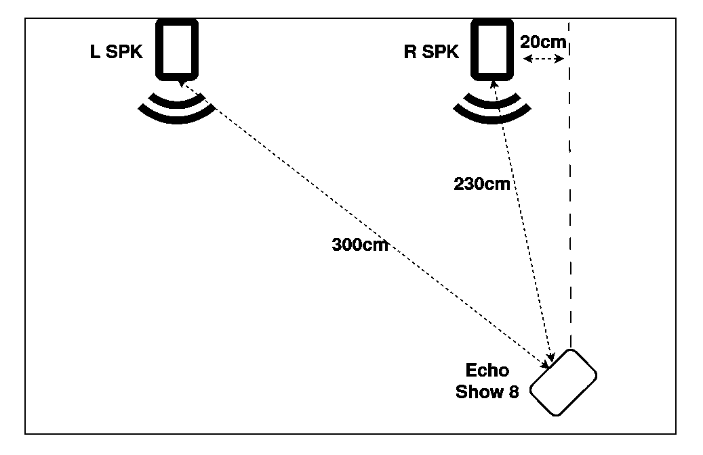

# Echo Show 8 Gen 2 (Athena): Wake-word performance with TECHO5 and Amazon factory ASP

**A controlled, automated acoustic comparison of the standard TECHO5 audio frontend and FrankenASP**
**Measurements:** 22–25 October 2026 · **Device:** Echo Show 8 Gen 2 (Athena) · **Software baseline:** TECHO5 v1.6.0 and the corresponding experimental FrankenASP adapter

## Why I ran these tests

The Echo Show 8 Gen 2 is an appealing local voice satellite: four microphones, capable audio hardware, and surprisingly good built-in stereo speakers. But its wake-word sensitivity with the standard TECHO5 audio frontend can be disappointing, especially when the Echo is playing music. Stereo playback makes the problem considerably more apparent.

While researching Athena's original audio architecture, I was able to run Amazon's factory Audio Signal Processor (ASP) through **FrankenASP**, an experimental frontend feeding the existing TECHO5 voice pipeline. That made a particularly useful comparison possible: **the same physical Echo, microphone array, microWakeWord model, room, speech recordings, playback conditions and automated scoring — but different audio processing before the detector.**

The difference was striking. With **normal-level speech (35)** and music playing on the Echo, standard TECHO5 recognized **45/60** wake-word attempts in mono and **22/60** in stereo. FrankenASP recognized **59/60** and **54/60**, respectively. The more revealing result, however, came from a much quieter source: barely intelligible background television speech arriving from a different direction could almost eliminate detection with the stock frontend.

The experiment is intended to measure and explain a performance gap, not to advocate shipping Amazon's proprietary software as part of TECHO5.

## What was compared

**Standard TECHO5:** Athena's native microphone-processing path, including its built-in audio preprocessing and playback echo handling.

**FrankenASP:** Amazon's original factory ASP operating on Athena's four physical microphone channels (96 kHz) and the stereo hardware playback reference (96 kHz). A separate worker delivers processed **16 kHz mono PCM16** into TECHO5's existing wake-word and Home Assistant voice pipeline.

Both frontends used the same microWakeWord model and voice-satellite infrastructure. I compared three playback conditions for each frontend:

1. **No music on the Echo.**
2. **Music through the Echo's own speakers in mono.**
3. **The same music through the Echo's own speakers in stereo.**

Throughout this report, *mono* and *stereo* refer **only to playback by the Echo's built-in loudspeakers**, not to the number of microphones, the incoming test signal, or the ASP output. The Amazon frontend remains multichannel on its microphone side in both playback modes.

## The acoustic setup

The tests took place in a furnished bedroom, approximately **4 × 3 m**, with upholstered furniture and substantial curtains. Two **Polk Audio ES15** speakers on the same long wall played the external test signals via a HiFi amplifier and an AirPlay/RAOP receiver. Both speakers faced straight toward the opposite wall; neither was deliberately aimed at the Echo.

The Echo Show 8 stood near the opposite wall, facing approximately the midpoint between the speakers. The physical distances were **3.00 m to the left speaker** and **2.30 m to the right speaker**. In plan view, the Echo was horizontally offset by approximately **20 cm** from the right speaker's forward centerline.

*Figure 1. Actual test arrangement. The two speakers radiate into the room without toe-in toward the Echo; dashed lines indicate the distances to the Echo, not loudspeaker aiming directions.*

The arrangement intentionally creates unequal propagation distances, off-axis speech, and an opportunity to put the intended voice and an interfering voice-like signal in different locations. The relatively close right speaker is much more favorable than the distant left speaker, especially when the right side emits interference.

### A realistic secondary-voice background

For the two interference scenarios, I did **not** use pink noise, an artificially loud television, or a synthetic competing voice. I used a recording of **real household ambience from my dining room**, made while a television played a popular-science program with frequent, clearly articulated narration.

I set this background recording to approximately **the lowest level at which individual words remained intelligible** — genuinely quiet, rather than a second entertainment source competing at full volume. It represents familiar secondary voices heard elsewhere in a house: distant TV dialogue, conversation, or speech leaking in from another room.

During music tests the Echo also played its own music, but the **external** TV recording should be understood as a controlled proxy for everyday low-level secondary speech, not as an assertion that someone normally listens to loud TV and music simultaneously.

Both the wake word and the secondary background originated from the *external* Polk speakers. The secondary speech was therefore **not present in the Echo's own playback reference** and could not simply be subtracted by playback AEC.

## Reproducible stimulus and procedure

I generated **12 fixed wake-word recordings of a predefined wake-word phrase** using six voices from a **professional proprietary TTS engine**. Each voice contributed two pronunciation/intonation variants. The same recordings were used across all frontends, speech levels and scenarios, with one presentation every **12 seconds**.

The custom microWakeWord model had been trained in part on this synthetic voice material. That was deliberate: the test was designed to emphasize differences in **microphone frontend processing**, not generalization to entirely unfamiliar voices. It is not a population-wide benchmark of wake-word recognition.

The external stereo stimulus was arranged in five scenarios:

| ID | Left Polk speaker (3.00 m) | Right Polk speaker (2.30 m) |
| --- | --- | --- |
| **S1** | Wake word | The same wake word, simultaneously |
| **S2** | Wake word | Silence |
| **S3** | Wake word | Quiet recorded household TV speech |
| **S4** | Silence | Wake word |
| **S5** | Quiet recorded household TV speech | Wake word |

**S1 is a useful counterpoint to low-signal explanations:** two loudspeakers reproduce the same recording, so two radiators contribute speech energy rather than one (nominally twice the total radiated acoustic power, or about **+3 dB**, for equal independent speaker outputs). This does **not** imply twice the pressure at the Echo's microphones: different distances, propagation delays, phase relationships and room reflections determine the actual local field.

The external AirPlay receiver was tested at three repeatable settings:

| AirPlay level | Interpretation |
| --- | --- |
| **30** | Quiet voice |
| **35** | Normal conversational voice |
| **40** | Loud voice |

These are **relative playback settings**, not sound-pressure levels measured with a calibrated microphone.

For the Echo's internal music I used **“Thinking of a Place” by The War on Drugs**, played through **Music Assistant / Sendspin**. The Echo volume was fixed at **46%**, speaker gain at **+6 dB**, and bass EQ at **−1 dB**. Automation restarted the same track before each scenario and aligned the beginning of the test speech to approximately the same point in the music (roughly 70 seconds into the track). For the additional level-30 tests, the active hardware playback reference was explicitly checked before every run.

Each scenario contained 12 scheduled presentations, or **60 presentations per full five-scenario configuration**. Scripts controlled mode switching, track restart, speech playback, and correlation with the wake-word events emitted by the Echo. **Only actual wake-word activations count as detections**; near misses do not.

An important qualification for interpreting the frontend comparison: although the configured model threshold was **0.85** in both, TECHO5's observed effective cutoff **during music** was **0.75** (due to playback-related slack), while FrankenASP's was **0.85**. Thus the results are measurements of the **complete operating frontends**, not a threshold-matched isolation of individual DSP algorithms. FrankenASP's advantage was observed despite this stricter effective threshold.

## Results: all playback conditions and speech levels

The completed comparison comprises **six frontend/playback configurations at three speech levels**. Each cell below contains **60** scheduled wake-word presentations.

| Audio frontend / Echo playback | 30 — Quiet | 35 — Normal | 40 — Loud |
| --- | ---: | ---: | ---: |
| Standard TECHO5 · no music | 46/60 (76.7%) | 46/60 (76.7%) | 49/60 (81.7%) |
| Standard TECHO5 · mono music | **35/60 (58.3%)** | 45/60 (75.0%) | 49/60 (81.7%) |
| Standard TECHO5 · stereo music | **13/60 (21.7%)** | 22/60 (36.7%) | 33/60 (55.0%) |
| FrankenASP · no music | 60/60 (100%) | 60/60 (100%) | 60/60 (100%) |
| FrankenASP · mono music | 41/60 (68.3%) | 59/60 (98.3%) | 60/60 (100%) |
| FrankenASP · stereo music | 45/60 (75.0%) | 54/60 (90.0%) | 59/60 (98.3%) |

The completed level-30 stock music results combine the initial controlled S1/S3/S5 measurements with four additional **S2/S4** measurements, performed with the same speech files, speaker positions, music track, playback levels and recognition pipeline. Their combined denominators are now exactly **60 attempts** for both mono and stereo. The completed level-35 and level-40 stock-no-music series also cover all five scenarios.

### The quiet-voice comparison

At level 30, with the Echo playing music, the stock frontend achieved **58.3% in mono** but only **21.7% in stereo**. FrankenASP achieved **68.3% in mono** and **75.0% in stereo**.

FrankenASP's slightly higher quiet-voice score in stereo than mono is an **observed outcome of these finite trials**, not evidence that stereo is inherently beneficial to its ASP. The important finding is that its performance remained substantially more robust than stock TECHO5 under stereo music playback.

The two scenarios added to complete the quiet-voice matrix were:

| Scenario · level 30 | TECHO5 mono | TECHO5 stereo | FrankenASP mono | FrankenASP stereo |
| --- | ---: | ---: | ---: | ---: |
| S2 — far left voice, right silent | 6/12 | **1/12** | 3/12 | 9/12 |
| S4 — near right voice, left silent | **12/12** | 6/12 | 10/12 | **12/12** |

These results are internally consistent with the larger pattern: speech from the nearer right side is much easier to detect, and stereo music penalizes the standard frontend more severely. One individual cell (FrankenASP mono S2 at 3/12 versus stock mono at 6/12) also illustrates why **per-scenario results matter**: the experiment does not show that FrankenASP wins every single combination.

### Normal-level speech: all five scenarios

At level 35, with the Echo playing music:

| Scenario | TECHO5 mono | TECHO5 stereo | FrankenASP mono | FrankenASP stereo |
| --- | ---: | ---: | ---: | ---: |
| S1 — same voice from both speakers | 12/12 | 7/12 | 12/12 | 12/12 |
| S2 — left voice, right silent | 11/12 | **1/12** | 12/12 | 9/12 |
| S3 — left voice, quiet TV speech right | **1/12** | **1/12** | **11/12** | **9/12** |
| S4 — right voice, left silent | 12/12 | 9/12 | 12/12 | 12/12 |
| S5 — right voice, quiet TV speech left | 9/12 | 4/12 | 12/12 | 12/12 |
| **Total** | **45/60** | **22/60** | **59/60** | **54/60** |

In other words, the factory frontend improved normal-voice detection by **23.3 percentage points in mono** and **53.3 percentage points in stereo** under the measured end-to-end conditions.

### S3: faint secondary speech can be devastating

S3 is the most revealing part of the experiment. The intended wake word comes from the **more distant and off-axis left speaker**, while a **closer right speaker** plays **barely intelligible household background speech**.

With music on the Echo, standard TECHO5 detected only **1/12 attempts in mono** and **1/12 in stereo** at normal voice level. FrankenASP detected **11/12 in mono** and **9/12 in stereo**.

Even **without music on the Echo**, the stock TECHO5 frontend detected only **2/12** S3 attempts at normal level and **4/12** at loud level. This matters because the failure does not require loud self-playback or difficult echo cancellation. The second speech source is quiet and spatially separated, but its impact is dramatic.

The opposite arrangement, S5, was considerably easier for the stock frontend: the wanted voice came from the closer right speaker and the faint TV background from farther left. At level 35, stock TECHO5 mono rose to **9/12**, versus **1/12** in S3. FrankenASP achieved **12/12** in S5 in both playback modes.

The same asymmetry appears in the no-TV conditions S2 and S4. This is strong practical evidence that **where the voice and competing sound originate** matters, rather than just how loudly the wake word is played.

### Simply turning up the voice is not a complete remedy

For standard TECHO5 with stereo music, increasing the external speech level from 30 to 35 to 40 increased the total detection count **13 → 22 → 33 out of 60**. This is the expected direction, but even the highest setting left nearly half of attempts undetected.

In the difficult S3 condition, TECHO5 stereo stayed at just **1/12** even at level 40, while FrankenASP stereo reached **12/12**.

S1 offers a complementary observation. Here **both external speakers play the wake word at once**, injecting more total speech energy into the room, with **no TV interference**. Nevertheless, TECHO5 stereo recognized only **7/12** normal-level attempts. FrankenASP stereo recognized **12/12**.

These outcomes are difficult to reconcile with a diagnosis of nothing more than poor microphone sensitivity or speech that is simply too quiet. They suggest a problem in the **processing of spatially distributed sounds**, especially under the Echo's own stereo playback.

## Interpretation

**First, the hardware is not inherently incapable of robust far-field wake detection.** Switching the input processing path on the same four microphones changes the results dramatically. The factory frontend demonstrates what Athena's acoustic hardware can achieve in these test conditions.

**Second, conventional AEC alone does not explain the full gap.** The quiet secondary speech in S3 and S5 is external: it does not exist in the Echo's music reference. A processing advantage in these conditions plausibly involves multichannel techniques such as spatial filtering, beamforming, adaptive beam selection or interference suppression, possibly in combination with AEC. This experiment compares entire frontends and does **not** isolate which particular factory algorithm is responsible.

**Third, good stereo playback and good wake-word detection are not mutually exclusive.** Standard TECHO5 loses a great deal of sensitivity while playing stereo music; FrankenASP demonstrates that the same hardware can retain high activation rates.

The results also show useful limits: these are **12-presentation per-scenario** measurements with synthetic voices, an intentionally familiar wake-word model, uncalibrated acoustic levels, and one specific room geometry. They measure successful wake-word activation, **not** the accuracy of following spoken commands, false-positive rates over days of use, or long-term operational reliability. The effective cutoff difference also prevents attribution of every percentage point to DSP in isolation.

## Why FrankenASP exists

I regard FrankenASP as a **research and benchmarking instrument**, not a request to replace TECHO5's own open-source frontend with proprietary Amazon components.

Recovering the factory ASP makes it possible to create an objective reference on identical hardware, expose unfavorable acoustic cases and evaluate future open algorithms against that reference. A useful long-term direction would be a **vendor-neutral, optional audio-frontend interface** for TECHO5, allowing independent experimental implementations without introducing an Amazon dependency into upstream firmware.

The project does **not** redistribute Amazon DSP binaries, calibration, firmware or proprietary runtime components.

## Conclusion

At normal speech level, with music playing through the Echo, the standard frontend detected **75.0% (mono)** and **36.7% (stereo)** of the scheduled wake words; FrankenASP detected **98.3%** and **90.0%**. The quiet-voice results — now measured across all five scenarios — show a particularly large stereo difference: **21.7% stock versus 75.0% FrankenASP**.

More compelling than the headline percentages is the spatial finding: a **barely intelligible secondary voice**, recorded in a normal household, almost eliminated wake detection when it arrived from the nearer side and the intended wake word came from farther away. Increasing the intended voice level, or playing the same word from two loudspeakers simultaneously, did not consistently solve the stock frontend's problems.

**Athena has considerable untapped potential as a local voice satellite.** The factory ASP provides a valuable reference for understanding that potential and for developing a better, independent, open-source voice frontend — ideally without having to choose between stereo sound and reliable wake-word detection.
